# KẾ HOẠCH TRIỂN KHAI DỰ ÁN: BẢO TÀNG ẢO 3D ĐẠI HỘI VII (1991)
> **Chủ đề: "Đổi mới, Ổn định và Phát triển" (Hà Nội, 24 – 27/6/1991)**  
> *Kiến trúc: Hành lang tuyến tính 4 Phòng Chuyên Đề + Phòng Quiz (Linear Corridor Flow)*

---

## 1. CẤU TRÚC HÀNH LANG TUYẾN TÍNH (4 PHÒNG CHUYÊN ĐỀ + QUIZ)

| Phòng | Tọa độ tâm (X, Y, Z) | Kích thước | Nội dung chính | Hiện vật trung tâm & Tương tác "đinh" |
| :---: | :---: | :---: | :--- | :--- |
| **Phòng 1** | **(0, 0, 0)** | Rộng 10 × Sâu 8 × Cao 4 | Khó khăn sau 5 năm Đổi mới 1986, lạm phát phi mã, biến động Liên Xô & Đông Âu, vì sao cần Đại hội VII | **Tương tác đinh:** Thanh trượt Trước/Sau (Comparison slider) + Tủ kính tem phiếu sổ gạo |
| **Phòng 2** | **(30, 0, 0)** | Rộng 10 × Sâu 8 × Cao 4 | Diễn biến Ba Đình, 1.176 đại biểu, bầu TBT Đỗ Mười, Cương lĩnh 1991 (6 đặc trưng CNXH, Tư tưởng Hồ Chí Minh là nền tảng tư tưởng) | **Hiện vật 3D:** Cuốn sách Cương lĩnh 1991 mạ vàng mở sẵn (lật từng trang tóm tắt) |
| **Phòng 3** | **(60, 0, 0)** | Rộng 10 × Sâu 8 × Cao 4 | Chiến lược đến năm 2000, kinh tế nhiều thành phần, kiềm chế lạm phát, đường lối "Việt Nam muốn là bạn với tất cả các nước", phá thế bao vây cô lập (Trung Quốc, Mỹ, ASEAN) | **Tương tác đinh:** Quả địa cầu đối ngoại 3D xoay với các điểm sáng ngoại giao & mốc son |
| **Phòng 4** | **(90, 0, 0)** | Rộng 10 × Sâu 8 × Cao 4 | Kinh tế phục hồi, GDP tăng bình quân 8,2%/năm, ổn định chính trị trong giông bão, tiền đề CNH - HĐH sang Đại hội VIII (1996) | Cổng vòm ánh sáng khải hoàn + Sổ lưu niệm điện tử (Digital Guestbook) |
| **Quiz** | **(120, 0, 0)** | Rộng 6 × Sâu 6 × Cao 3 | 6 câu hỏi cốt lõi, tinh túy nhất về thời gian, nhân sự, Cương lĩnh, chiến lược, đối ngoại | Bục đài sen vinh danh 3D phát sáng, Phản hồi giải thích chi tiết, 3 hạng Huy hiệu (Vàng/Bạc/Đồng) + Xuất Bằng khen PNG |

---

## 2. SƠ ĐỒ BỐ TRÍ TUYẾN TÍNH (NHÌN TỪ TRÊN XUỐNG)

```mermaid
flowchart LR
    W["[Màn hình chào]"] --> P1["PHÒNG 1 (x=0)<br>Bối cảnh lịch sử<br>(Slider Trước/Sau)"]
    P1 -->|Cửa x=5| P2["PHÒNG 2 (x=30)<br>Nội dung Đại hội & Cương lĩnh<br>(Sách Cương lĩnh 3D)"]
    P2 -->|Cửa x=35| P3["PHÒNG 3 (x=60)<br>Chiến lược & Đối ngoại<br>(Quả địa cầu xoay)"]
    P3 -->|Cửa x=65| P4["PHÒNG 4 (x=90)<br>Kết quả & Ý nghĩa<br>(Cổng vòm & Lưu bút)"]
    P4 -->|Cửa x=95| Q["PHÒNG QUIZ (x=120)<br>Bục trắc nghiệm 3D<br>(6 câu hỏi + Bằng khen)"]

    style W fill:#1e293b,stroke:#475569,stroke-width:2px,color:#f8fafc
    style P1 fill:#450a0a,stroke:#d97706,stroke-width:2px,color:#fef08a
    style P2 fill:#450a0a,stroke:#d97706,stroke-width:2px,color:#fef08a
    style P3 fill:#450a0a,stroke:#d97706,stroke-width:2px,color:#fef08a
    style P4 fill:#450a0a,stroke:#d97706,stroke-width:2px,color:#fef08a
    style Q fill:#78350f,stroke:#fbbf24,stroke-width:2px,color:#ffffff
```

---

## 3. CÁC TÍNH NĂNG VÀ CẢI TIẾN TRẢI NGHIỆM NGƯỜI DÙNG (UX)

1. **Hành lang tuyến tính trực quan**: Người xem bước từ Phòng 1 đến Phòng 4 và sang Phòng Quiz một cách liền mạch theo đúng dòng chảy thời gian lịch sử.
2. **Cửa thông phòng thông minh (2 chiều)**: 
   - Bấm chuột vào cửa ra (tường phải) hoặc bước qua khung cửa để teleport sang phòng kế tiếp.
   - Bấm chuột vào cửa vào (tường trái) hoặc bước lùi để quay lại phòng trước đó.
3. **Thanh điều hướng đỉnh màn hình (5 nút nhảy nhanh)**: Cung cấp 5 nút chọn trực tiếp `[1. Bối cảnh]`, `[2. Nội dung & Cương lĩnh]`, `[3. Chiến lược & Đối ngoại]`, `[4. Kết quả & Ý nghĩa]`, `[★ Quiz]` giúp dịch chuyển tức thời mọi lúc.
4. **Tối ưu hiệu năng thông minh (`visible = false`)**: Hệ thống tự động ẩn các phòng ở xa, chỉ hiển thị phòng hiện tại và kế cận, đảm bảo 60 FPS mượt mà trên mọi thiết bị.
5. **Khắc phục triệt để lỗi đơ chuột**: Khôi phục Pointer Lock tức thì khi đóng modal qua `resumeExploration()`, hỗ trợ phím `Escape` và click ra ngoài backdrop.
6. **Tour tự động thuyết minh AI**: 5 trạm dừng chân tương ứng 5 phòng, tự động xoay góc nhìn và đọc bài giảng lịch sử.
