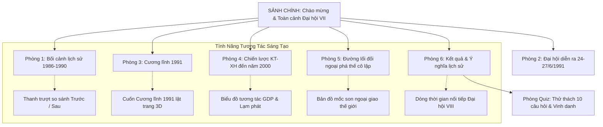

# ĐỀ TÀI: BẢO TÀNG ẢO 3D "ĐẠI HỘI VII CỦA ĐẢNG (1991)"
> **Chủ đề: "Đổi mới, Ổn định và Phát triển" (Hà Nội, 24 – 27/6/1991)**  
> *Không gian triển lãm 3D tương tác trực quan trên nền tảng Web*

---

## 1. TỔNG QUAN ĐỀ TÀI

- **Tên dự án:** Bảo tàng ảo 3D: Đại hội VII của Đảng (1991) – Đổi mới, Ổn định và Phát triển.
- **Bối cảnh lịch sử:** Đại hội đại biểu toàn quốc lần thứ VII của Đảng Cộng sản Việt Nam diễn ra từ ngày 24 đến 27/6/1991 tại Thủ đô Hà Nội. Đây là thời điểm bước ngoặt sống còn khi công cuộc Đổi mới sau 5 năm (1986 - 1990) còn nhiều ngổn ngang khó khăn, lạm phát phi mã và chế độ XHCN ở Liên Xô và Đông Âu lâm vào khủng hoảng, tan rã.
- **Ý nghĩa lịch sử:** Đại hội VII đã thông qua bản **Cương lĩnh 1991** lịch sử, khẳng định lấy chủ nghĩa Mác-Lênin và tư tưởng Hồ Chí Minh làm nền tảng tư tưởng, kim chỉ nam cho hành động; thông qua Chiến lược ổn định và phát triển kinh tế - xã hội đến năm 2000; đồng thời khởi xướng đường lối đối ngoại rộng mở *"Việt Nam muốn là bạn với tất cả các nước trong cộng đồng thế giới"*.
- **Mục tiêu sản phẩm:** 
  - Số hóa toàn diện tư liệu, hình ảnh và hiện vật lịch sử của Đại hội VII thành không gian 3D tương tác thời gian thực trên trình duyệt web.
  - Phân chia logic theo **Bối cảnh $\rightarrow$ Nội dung $\rightarrow$ Kết quả & Ý nghĩa**, tích hợp các cơ chế tương tác sáng tạo (so sánh trước/sau, lật sách Cương lĩnh, biểu đồ kinh tế, bản đồ ngoại giao và trắc nghiệm tri thức).

---

## 2. CÔNG NGHỆ & KIẾN TRÚC KỸ THUẬT

- **Core Engine:** `Three.js` (WebGL, HTML5 Canvas) – Chạy trực tiếp trên trình duyệt, không cần cài đặt phần mềm, gửi đường dẫn là trải nghiệm ngay.
- **Hệ thống điều khiển:** `PointerLockControls` cho máy tính (phím `WASD` + xoay chuột 360°) và Touch Controller cho thiết bị di động.
- **Cơ chế tương tác:** `Raycasting` nhận diện tầm nhìn người xem; khi nhìn vào hiện vật sẽ đổi màu tâm ngắm và hiện chỉ dẫn tương tác.
- **Âm thanh & Giọng đọc:**
  - Nhạc nền giao hưởng trang nghiêm tạo thời gian thực bằng `Web Audio API` (Synthesizer).
  - Thuyết minh tự động bằng `Web Speech API` (AI Speech synthesis tiếng Việt chuẩn).
- **Giao diện đa phương tiện (HUD Overlay):** HTML5/CSS3 với bản đồ con (Minimap 2D), bảng chuyển phòng tức thời (Teleport), và hệ thống Quiz khảo hạch.

---

## 3. CẤU TRÚC KHÔNG GIAN BẢO TÀNG (SẢNH + 6 PHÒNG + QUIZ)

---

## 4. NỘI DUNG CHI TIẾT TỪNG PHÒNG & ĐIỂM SÁNG TẠO

### Sảnh chính: Chào mừng & Không gian Hội tụ
- **Không gian:** Sảnh vòm trang trọng, trung tâm là đài biểu tượng Búa Liềm rực sáng vàng, bao quanh là các cổng vòm dẫn vào 6 phòng chuyên đề.
- **Nội dung:** Ảnh toàn cảnh Đại hội VII, khẩu hiệu hành động *"Đổi mới, Ổn định và Phát triển"*, nhạc nền trang nghiêm và bảng hướng dẫn tương tác.

---

### Phòng 1: Bối cảnh lịch sử (Đất nước & Thế giới 1986 - 1990)
- **Nội dung chính:**
  1. *Khó khăn sau 5 năm Đổi mới:* Lạm phát phi mã 3 con số (774,7% năm 1986), đời sống nhân dân và lực lượng vũ trang vô cùng gian khổ.
  2. *Biến động chấn động ở Liên Xô và Đông Âu:* Chế độ XHCN ở Đông Âu sụp đổ, Liên Xô khủng hoảng trầm trọng; viện trợ và bạn hàng truyền thống bị cắt giảm đột ngột.
  3. *Yêu cầu lịch sử cấp bách:* Đòi hỏi Đảng phải kiên định con đường đi lên CNXH, tìm ra bước đi mới vừa giữ vững độc lập vừa ổn định phát triển.
- **💡 Điểm sáng tạo tương tác:** **Thanh trượt so sánh Trước và Sau (Comparison Slider)** – Người xem kéo thanh trượt giữa số liệu lạm phát 774,7% (1986) sang mức kiểm soát 5,2% (sau 1991) để thấy sự chuyển biến kỳ diệu.

---

### Phòng 2: Đại hội diễn ra (Hà Nội, 24 – 27/6/1991)
- **Nội dung chính:**
  1. *Khai mạc Đại hội:* Họp tại Hội trường Ba Đình với 1.176 đại biểu đại diện cho hơn 2,1 triệu đảng viên cả nước cùng nhiều đoàn đại biểu quốc tế.
  2. *Nhân sự Đại hội:* Đồng chí **Đỗ Mười** được tín nhiệm bầu giữ chức Tổng Bí thư Ban Chấp hành Trung ương; bầu Bộ Chính trị gồm 13 đồng chí.
  3. *Không khí Đại hội:* Dân chủ, thẳng thắn, trí tuệ, biểu thị ý chí sắt đá của toàn Đảng, toàn dân tiếp tục kiên định ngọn cờ cách mạng.
- **💡 Điểm sáng tạo tương tác:** Chân dung tư liệu, âm thanh phát biểu khai mạc và mô phỏng không gian hội trường Ba Đình lịch sử.

---

### Phòng 3: Cương lĩnh 1991 (Ngọn cờ tư tưởng dẫn đường)
- **Nội dung chính:**
  1. *Cương lĩnh xây dựng đất nước trong thời kỳ quá độ lên CNXH (Cương lĩnh 1991):* Định hình mô hình CNXH ở Việt Nam gồm **6 đặc trưng cơ bản**.
  2. *Đột phá tư duy lý luận:* Lần đầu tiên Đảng khẳng định lấy **chủ nghĩa Mác-Lênin và tư tưởng Hồ Chí Minh** làm nền tảng tư tưởng, kim chỉ nam cho hành động.
  3. *Bảy phương hướng cơ bản:* Định hướng toàn diện về kinh tế, chính trị, văn hóa, xã hội, quốc phòng - an ninh và xây dựng Đảng.
- **💡 Điểm sáng tạo tương tác:** **Cuốn Cương lĩnh 1991 lật trang (Interactive Book)** – Người xem bấm vào từng tab chương mục để xem tóm tắt 6 đặc trưng và 7 phương hướng phát triển.

---

### Phòng 4: Chiến lược kinh tế - xã hội đến năm 2000
- **Nội dung chính:**
  1. *Chiến lược ổn định và phát triển KT-XH đến năm 2000:* Đặt mục tiêu vượt qua khủng hoảng, ổn định đời sống, tăng gấp đôi GDP so với năm 1990.
  2. *Phát triển kinh tế hàng hóa nhiều thành phần:* Vận hành theo cơ chế thị trường có sự quản lý của Nhà nước; giải phóng triệt để mọi sức sản xuất của nhân dân.
  3. *Kỳ tích kiềm chế lạm phát:* Áp dụng lãi suất dương, đưa lạm phát từ 67,4% (1990) xuống mức một con số (5,2% năm 1993).
- **💡 Điểm sáng tạo tương tác:** **Biểu đồ cột tương tác GDP & Lạm phát (Interactive Bar Chart)** – Trực quan hóa tốc độ tăng trưởng kinh tế nhảy vọt từ 5,1% (1990) lên 9,5% (1995).

---

### Phòng 5: Đường lối đối ngoại (Đa phương hóa, đa dạng hóa)
- **Nội dung chính:**
  1. *Tuyên bố lịch sử:* *"Việt Nam muốn là bạn với tất cả các nước trong cộng đồng thế giới, phấn đấu vì hòa bình, độc lập và phát triển"*.
  2. *Bình thường hóa quan hệ Việt Nam – Trung Quốc (11/1991):* Chuyến thăm lịch sử của Tổng Bí thư Đỗ Mười và Thủ tướng Võ Văn Kiệt khép lại thời kỳ căng thẳng.
  3. *Phá tan thế bao vây cô lập (1994 - 1995):* Mỹ dỡ bỏ cấm vận (1994), bình thường hóa quan hệ ngoại giao Việt - Mỹ và Việt Nam chính thức gia nhập ASEAN (7/1995).
- **💡 Điểm sáng tạo tương tác:** **Bản đồ mốc son ngoại giao thế giới (Diplomatic Map Milestones)** – Thể hiện các điểm sáng khi Việt Nam lần lượt thiết lập quan hệ hữu nghị với các nước lớn và khu vực.

---

### Phòng 6: Kết quả và ý nghĩa lịch sử (1991 - 1996)
- **Nội dung chính:**
  1. *Kinh tế phục hồi thần kỳ:* Tăng trưởng GDP bình quân đạt 8,2%/năm (1991-1995); an ninh lương thực được giữ vững, công nghiệp tăng tốc.
  2. *Ổn định chính trị - xã hội:* Đất nước đứng vững vàng trước chấn động lịch sử khi Liên Xô sụp đổ, giữ vững độc lập chủ quyền.
  3. *Ý nghĩa lịch sử:* Chuẩn bị tiền đề vững chắc về lý luận và thực tiễn để Đại hội VIII (1996) tuyên bố đất nước bước vào thời kỳ đẩy mạnh công nghiệp hóa, hiện đại hóa.
- **💡 Điểm sáng tạo tương tác:** **Dòng thời gian nối tiếp (Interactive Timeline)** – Cầu nối liền mạch từ Đại hội VII (1991) đến Hội nghị giữa nhiệm kỳ (1994) và Đại hội VIII (1996).

---

### Phòng Quiz: Thử thách tri thức Đại hội VII (10 câu hỏi)
- Bộ 10 câu hỏi bao quát:
  1. Thời gian và địa điểm diễn ra Đại hội VII.
  2. Chủ đề trung tâm: "Đổi mới, ổn định và phát triển".
  3. Tổng Bí thư Đỗ Mười.
  4. Sáu đặc trưng của xã hội XHCN trong Cương lĩnh 1991.
  5. Việc khẳng định Tư tưởng Hồ Chí Minh là nền tảng tư tưởng.
  6. Mục tiêu tăng gấp đôi GDP trong Chiến lược kinh tế - xã hội đến năm 2000.
  7. Cơ chế kinh tế hàng hóa nhiều thành phần vận hành theo cơ chế thị trường.
  8. Khẩu hiệu đối ngoại "Việt Nam muốn là bạn với tất cả các nước".
  9. Bình thường hóa quan hệ Việt - Trung tháng 11/1991.
  10. Tốc độ tăng trưởng GDP bình quân 8,2%/năm giai đoạn 1991 - 1995.
- Cơ chế phản hồi tức thì, giải thích lý do đúng/sai và cấp **Chứng nhận vinh danh** có thể chụp lưu làm kỷ niệm.

---

## 5. HƯỚNG DẪN TRẢI NGHIỆM & THUYẾT TRÌNH

1. **Khởi chạy ứng dụng:**
   - Chạy lệnh: `python -m http.server 8080`
   - Truy cập: `http://localhost:8080`
2. **Kịch bản thuyết trình 3 phút:**
   - **Phút 1:** Đứng tại Sảnh giới thiệu bối cảnh năm 1991 và chủ đề *"Đổi mới, ổn định và phát triển"*. Đi vào Phòng 1 kéo thanh trượt so sánh lạm phát.
   - **Phút 2:** Vào Phòng 3 lật trang Cương lĩnh 1991 nói về Tư tưởng Hồ Chí Minh và 6 đặc trưng XHCN. Sang Phòng 4 bấm xem biểu đồ GDP.
   - **Phút 3:** Sang Phòng 5 xem các mốc phá thế cô lập ngoại giao, sau đó vào Phòng Quiz làm thử 1-2 câu trắc nghiệm để ban giám khảo thấy tính tương tác cao của dự án.
